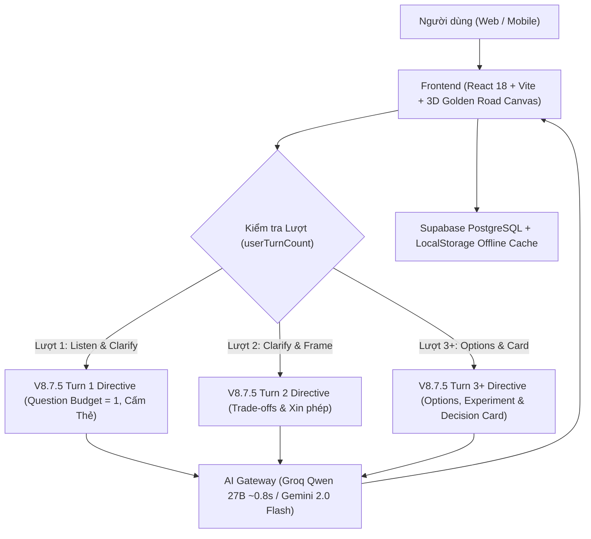

# LIFE LAB — CONVERSATION SYSTEM & DECISION MODE
## BẢN CHUẨN HÓA KIẾN TRÚC & TIẾN ĐỘ HỘI THOẠI HIỆN CÓ: V8.7.5
> **Hệ thống Web Phản tư & Thiết kế Trải nghiệm Sống**  
> **Chuẩn đặc tả**: Spec V8.7.5 Verified Implementation Standard + Decision Mode V1.0  
> **Trạng thái**: Đã nghiệm thu & Cập nhật mới nhất ngày 31/10/2026  
> **Production Live**: [https://union-fam.vercel.app/](https://union-fam.vercel.app/)

---

## 1. ĐỊNH VỊ VÀ ĐẶC ĐIỂM CỐT LÕI CỦA HỆ THỐNG HỘI THOẠI HIỆN CÓ

Life Lab V8.7.5 là hệ thống đối thoại phản tư và đồng hành ra quyết định dành riêng cho người trẻ đi làm (23–35 tuổi). Ứng dụng đã loại bỏ hoàn toàn các kịch bản cứng (Hardcode) để chuyển sang AI thuần động, kết hợp kiểm soát trạng thái đa tầng (Progressive Disclosure), Thẻ Quyết Định giữ chân khách hàng và tính năng Reset (Làm mới) phiên linh hoạt:

1. **Value-First & Lắng nghe Thấu cảm (Ngắn gọn & Súc tích)**:
   - Lắng nghe và đồng cảm trúng trọng tâm cảm xúc ngầm ẩn ngay trong lượt đầu.
   - Mang lại giá trị được xác nhận (First Session Value) trong tối đa 3 lượt đối thoại.
   - Không phán xét, không bói chữ tâm lý, không đưa bài giảng phân tích não bộ, không đưa giải pháp dồn dập ở lượt đầu.
   - Phong cách phản hồi cô đọng, gãy gọn, vừa vặn trên màn hình điện thoại (Concise & Punchy).
2. **Progressive Disclosure Gate**:
   - *Conversation First*: Hội thoại và làm rõ bối cảnh là ưu tiên số 1.
   - Thẻ Quyết Định bị ẩn hoàn toàn ở Lượt 1 và Lượt 2 để người dùng không cảm thấy bị ép làm bài tập.
   - Chỉ xuất hiện và đúc kết khi nan đề đã được làm rõ ngọn ngành ở Lượt 3 trở đi.
3. **AI Thuần Động 100% & Khả năng Tự Sửa (Zero Hardcode & Repair)**:
   - Đã xóa sạch toàn bộ 293 dòng kịch bản if-else tĩnh (Singapore, Nurse, Layoff...).
   - Động cơ Groq Qwen-2.5-27B suy luận siêu tốc (~0.8s) không có độ trễ.
   - Khi người dùng đính chính ("không phải vậy", "ý mình là..."), AI khiêm tốn tiếp thu và sửa ngay cách hiểu trong phiên.
4. **Tính Năng Làm Mới (Reset Conversation)**:
   - Nút "Làm mới" ngay trên thanh tiêu đề khung chat và nút "Bắt đầu lại" tại thanh nhập liệu.
   - Xóa trắng cache LocalStorage và khởi động phiên mới trong 1 click mà không cần tải lại trang.

---

## 2. KIẾN TRÚC HỆ THỐNG VÀ DÒNG CHẢY DỮ LIỆU ĐA TẦNG

1. **Frontend Web Client**: React 18.3.1 + Vite 6 + Tailwind CSS. Tích hợp trải nghiệm cuộn scrollytelling Con Đường Thức Tỉnh (Moving Cosmic Road) và cửa sổ chat phản tư.
2. **AI Gateway Đa Tầng**:
   - *Primary*: Groq Cloud High-Speed (`qwen/qwen3.8-27b`) với độ trễ sub-second (~0.8s) mang lại cảm giác phản hồi tức thì.
   - *Secondary*: Google Gemini 2.0 / 2.5 Flash API (khi cấu hình Gemini key).
   - *Fallback*: Cloudflare Edge Worker AI + Local Sanctuary Engine đảm bảo hoạt động ngoại tuyến khi mất mạng.
3. **Persistence & Cloud Sync**: Supabase PostgreSQL lưu phiên đối thoại, đúc kết kết quả (Session Outcomes), bộ nhớ ký ức (Memory Center) và đồng bộ LocalStorage offline-first.

---

## 3. CHU TRÌNH HỘI THOẠI CHUẨN HÓA V8.7.5 THEO LƯỢT (STEP LIFECYCLE)

| Chặng | Tên giai đoạn | Trạng thái (Canonical State) | Hành vi bắt buộc | Quy tắc cấm & Gating |
| :---: | :--- | :--- | :--- | :--- |
| **Chặng 1** | **Lắng nghe & Làm rõ (Listen & Clarify)** | `WHAT_MATTERS_NOW` -> `CONTINUE_EXPLORATION` | - Phản chiếu thấu cảm đúng 1 câu ngắn gọn. - Question Budget: Đúng **1 câu hỏi khai vấn duy nhất** khám phá bối cảnh. | - CẤM TIỆT đưa lời khuyên hoặc giải pháp. - CẤM TIỆT nhắc đến "Thẻ Quyết Định" (Gate ẩn 100%). |
| **Chặng 2** | **Clarify sâu & Định hình (Frame Decision)** | `CONTINUE_EXPLORATION` / `PERMISSION_BEFORE_ADVICE` | - Tiếp thu dữ kiện người dùng vừa bổ sung. - Đào sâu nguyên nhân gốc rễ hoặc gọi tên thế lưỡng nan (Trade-offs). - Xin phép người dùng trước khi đưa phương án. | - Vẫn giữ Thẻ Quyết Định ẩn trừ khi người dùng chủ động yêu cầu. - Cấm sử dụng thuật ngữ kỹ thuật. |
| **Chặng 3** | **Phương án & Thẻ Đúc kết (Options & Card)** | `EXPLORE_OPTIONS` -> `LIFE_EXPERIMENT` -> `CHECKPOINT` | - Đưa ra 2–3 hướng tiếp cận khác biệt (rủi ro thấp/vừa/cao, tính đảo ngược). - Thiết kế 1 thực nghiệm vi mô 7 ngày an toàn. - Gợi mở Thẻ Quyết Định để người dùng lưu giữ thành quả. | - Không ép buộc người dùng phải chọn ngay. - Thực nghiệm vi mô phải dễ đảo ngược (High Reversibility). |

---

## 4. NGUYÊN TẮC NGÂN SÁCH CÂU HỎI (QUESTION BUDGET) & ACTION OUTPUT CONTRACT

- **Đúng 1 câu hỏi chính mỗi lượt**: Triệt tiêu hoàn toàn tình trạng hỏi dồn 2–3 câu cùng lúc gây căng thẳng hoặc cảm giác bị thẩm vấn.
- **Tối đa 2 lượt clarify liên tiếp**: Sau đó bắt buộc phải chuyển sang Phản chiếu, Định hình nan đề hoặc xin phép đưa phương án.
- **Action Output Contract (Mục 8 V8.7.5)**: Khi người dùng đưa ra câu lệnh hành động cụ thể (`so sánh`, `tạo phương án`, `đặt ngưỡng`, `thử thế nào`):
  + Phản chiếu tối đa 1 câu.
  + Cung cấp ngay đầu ra có cấu trúc dùng được (bảng so sánh, tiêu chí, điểm chưa rõ).

---

## 5. CƠ CHẾ THẺ QUYẾT ĐỊNH (DECISION CARD V1.0 - CHUẨN 7 MỤC)

Thẻ Quyết Định đóng vai trò là mô hình đúc kết (Projection Model), tự động bóc tách thời gian thực qua Groq JSON Mode từ hội thoại thật của người dùng:

1. **Câu hỏi Quyết định (Decision Question)**: Chuẩn hóa nan đề trăn trở thành một câu hỏi hành động rõ ràng.
2. **Tiêu chí Cốt lõi (Criteria - 3 đến 4 mục)**: Sức khỏe, an toàn tài chính, sự bình an, phát triển cá nhân.
3. **Ranh giới Đỏ không đánh đổi (Hard Constraints)**: Ngưỡng không thể thỏa hiệp (quỹ dự phòng, ranh giới gia đình).
4. **Ba Phương án Khả thi (Options: 1 - 2 - 3)**: Phương án an toàn thử nghiệm, phương án dấn thân có điểm dừng, phương án giữ nguyên trạng có chủ đích.
5. **Điểm Chưa chắc chắn & Điểm dừng (Uncertainty & Stop Rule)**: Xác định ẩn số lớn nhất kèm quy tắc dừng lỗ nếu kết quả không như kỳ vọng.
6. **Thực nghiệm Vi mô 7 ngày (Micro-experiment)**: Hành động nhỏ ngoài đời thực trong 7 ngày để thu thập dữ liệu thay vì suy đoán mơ hồ.
7. **Ngày Nhìn Lại & Chuyển Giao (Review Date & Transfer to Lab)**: Chuyển giao trực tiếp sang Cổng 2 (Phòng Thí Nghiệm) để theo dõi và điểm danh.

---

## 6. CÁC GIAO THỨC AN TOÀN & BẢO VỆ TÂM LÝ (SAFEGUARDS P0-01)

- **Crisis Safety Flow**: Khi phát hiện dấu hiệu tự hại / khủng hoảng, ngắt tức thì flow coaching, hiển thị danh thiếp đường dây nóng và vô hiệu hóa ô chat.
- **User Stop Protocol (P0-01)**: Khi người dùng nói "dừng", "thôi", "stop", hệ thống xác nhận và dừng ngay lập tức, không hỏi thêm câu hỏi nào, không ép checkpoint hay memory.
- **Low Energy Mode**: Khi người dùng mệt mỏi hoặc kiệt sức (năng lượng <= 3), AI tự động chuyển sang câu ngắn gọn, ấm áp, tối đa 2 lựa chọn nhẹ nhàng, không giao bài tập.
- **Granular Memory Permission**: Xem trước chính xác nội dung định ghi nhớ, cho phép duyệt hoặc từ chối từng trường (Allow/Edit/Deny), hỗ trợ chế độ không lưu (No Memory).

---

## 7. BỐ CỤC ĐIỀU HƯỚNG 3 CỔNG VÒM TRẢI NGHIỆM

1. **Cổng 1: Con Đường Thức Tỉnh (Awakening Road)**: Giao diện 3D Golden Road Scrollytelling kết hợp Chatbot phản tư và Thẻ Quyết Định.
2. **Cổng 2: Thực Nghiệm Đời Sống (Life Experiment Lab)**: Quản lý và điểm danh các thử nghiệm 7 ngày vi mô chuyển giao từ Cổng 1.
3. **Cổng 3: Ngân Hàng Ký Ức (Granular Memory Center)**: Quản lý các đúc kết và quyền riêng tư bộ nhớ người dùng.

---

## 8. THÔNG SỐ KỸ THUẬT & TRẠNG THÁI HIỆN TẠI

- **Frontend**: React 18.3.1, TypeScript 5.6.3, Vite 6.4.4, Tailwind CSS, Lucide Icons, Canvas Confetti.
- **AI Gateway**: Groq Cloud High-Speed (`qwen/qwen3.8-27b`, latency ~0.8s), Google Gemini 2.0/2.5 Flash.
- **Production Live URL**: [https://union-fam.vercel.app/](https://union-fam.vercel.app/)
- **Repository Git**: `github.com:Jay-Gabriel/unionFam` (Branch `main`, Commit `4094c09`).
- **Khởi chạy cục bộ**: `cd /home/jay/Desktop/unionFam && npm run dev`
